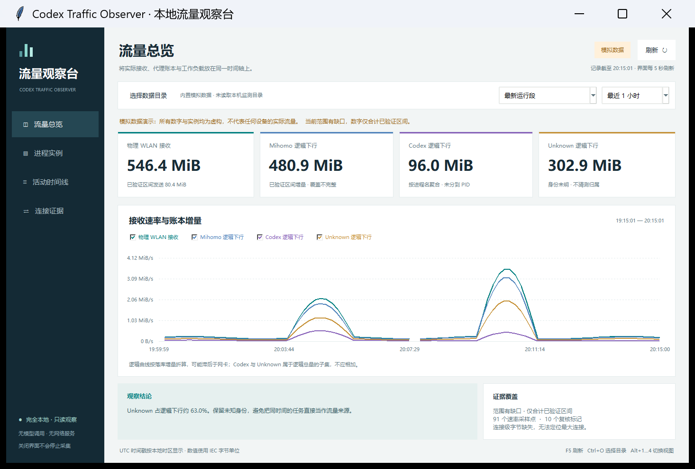

# Codex Traffic Observer

**离线查看 Codex 流量、进程与活动时间线。保持证据边界，不把代理账本当作精确应用账单。**

Offline desktop dashboard and optional read-only Windows collector. Python standard library only: no model calls, telemetry, web server, proxy changes, or packet interception.



截图使用随项目提供的虚构演示数据，包含明确的“演示”标记；仓库不包含作者的真实流量、进程、日志或本机路径。

## 快速打开

需要 **Python 3.11+，含 Tkinter**。Windows 的常见 Python 安装已包含 Tk；程序无需 pip 安装任何第三方运行库。

下载或克隆仓库后，双击 `Open-Observer.cmd`，选择已有监测结果目录。也可以在仓库目录运行：

```powershell
python -B -m traffic_observer gui --data-dir "C:\TrafficObservations"
```

先体验界面，无需访问真实网络或进程：

```powershell
python -B -m traffic_observer gui --demo
```

界面每 5 秒读取一次本地结果。查看器与监测器彼此独立：**打开界面不会启动采集，关闭界面不会停止采集。**没有网页服务或监听端口。已有采集程序正在运行时，直接选择其输出目录即可，不需要重新启动它。

## 可以看到什么

- **概览**：所选时间段的物理 WLAN 收发、Mihomo 逻辑下行、Codex 与 Unknown 增量及趋势。
- **实例**：PID、父 PID、开始时间、进程类别、采样时间和缓存状态；进程存在不等于正在产生下载。
- **活动**：既有元数据记录中的完成、失败、恢复等事件；日志模块行数不会当成模型调用数。
- **连接**：来源确实提供的连接记录；缺少连接级来源时，明确展示不可用，不生成虚假连接或流量归属。
- **时间筛选**：独立运行段、最近 15 分钟、1 小时、4 小时或当前保留范围。

物理网卡和逻辑账本的时间、覆盖范围与计数层次不同，曲线只用于比较。Mihomo 写入延迟可能造成短时错位。`chatgpt.com` 是正常服务域名；它本身不能证明异常或响应内容类型。

## 可选：开始新的采集

**已有监测器时，无需运行这一段。**公开版采集器是独立的最小 Windows 实现，默认读取物理 WLAN 与 Windows Codex 进程元数据，不扫描私人项目，不执行 WSL，不读取会话或命令行。

```powershell
python -B -m traffic_observer collect --output-dir "C:\TrafficObservations" --interval 10
```

若希望读取现存 Clash Party 流量账本，明确指定本机数据库：

```powershell
python -B -m traffic_observer collect --output-dir "C:\TrafficObservations" --mihomo-db "$env:APPDATA\mihomo-party\traffic-usage.db"
```

仅用 SQLite 只读方式读取一种统计分辨率，对累计值做差。数据库不可访问或查询超时就记录缺口，不修复、不重置、不停止服务。没有 Mihomo HTTP API、密钥读取、端口发现或命名管道访问。

退出这个采集器可按 Ctrl+C，或从另一个终端运行：

```powershell
python -B -m traffic_observer stop --data-dir "C:\TrafficObservations"
```

停止命令只写本工具采集器的运行标志，不终止 Codex、代理、WSL 或任何工作负载。原有外部监测器使用其自己的退出方法。

## 数据与隐私

查看器兼容以下监测输出：`physical_network.csv`、`sample_summary.csv`、`process_snapshots.csv`、`codex_activity.csv`、`live_connections.csv`、`anomaly_windows.csv`、`monitor_health.csv`、`monitor_state.json`。单个数据源缺失时可继续查看其余来源。公开版采集器不具备所有原始审计适配器，因此部分活动或工作负载标签来自导入数据，而非公开版的自动发现。

所有真实观测都应存放在源码仓库之外。`.gitignore` 排除运行日志、数据库、CSV 和状态文件；只有 `traffic_observer/demo/` 下明确标记的虚构数据例外。界面只读取本地文件，不上传数据。请勿把含真实路径、活动时间或进程信息的截图与日志直接贴到公开 issue。

详细语义见 [数据格式](docs/data-format.md)、[隐私与权限](docs/privacy.md)。这个工具不能解密 HTTPS、判断模型输出内容、还原被清理的历史，或仅凭进程名称将代理字节分配给某个聊天。

## 开发与验证

```powershell
python -B -m unittest discover -s tests -v
python -B tools/check_public_tree.py
```

测试使用临时目录和合成记录，不读取本机私人数据、不连接模型，也不启动真实网络采集。查看器使用 Tkinter，在没有显示服务的环境中 GUI 运行检查会标为跳过。核心数据解析与采集算法可无界面测试。

包入口为 `python -m traffic_observer`；`pyproject.toml` 也提供可选的 `traffic-observer` 命令安装入口。默认使用中文界面，代码与结构保持简单，便于添加其它已经脱敏的元数据来源。

MIT License。非 OpenAI 或 Mihomo 官方项目。
